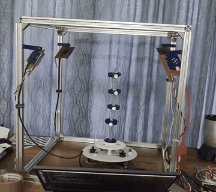
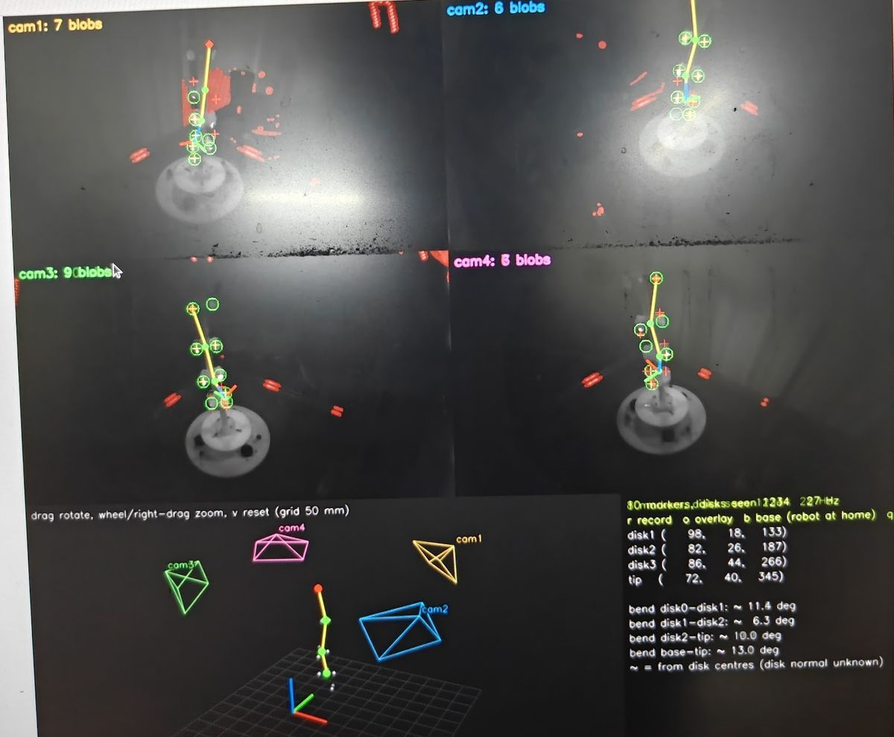

# Camera Sync

Synchronized four-camera infrared motion capture for a soft continuum robot, built on low-cost USB cameras and written in Python from the V4L2 driver layer up.

**Project page:** https://kiranthiyagarajan.github.io/camera_sync/

<p align="center">
  
</p>

| | |
|---|---|
| **Cameras** | 4 × IR USB cameras, 1280 × 720 at 118.55 fps (or 60 fps) |
| **Sync** | < 1 ms between cameras after interpolating to a common time |
| **Stability** | 0 frames lost in a 2-hour stream across all four cameras |
| **Output** | Live 3D marker positions and the robot's shape as a bend per segment |

## What it does

A soft robot bends along its whole length, so there are no joint angles to read. This project measures its shape from outside so the data can train a control model.

- **The robot:** about 300 mm tall, with four PLA disks roughly 70 mm apart on a flexible backbone. Each disk carries retroreflective markers around its rim. Three stepper motors bend it by winding tendons onto spools (ESP32 + DRV8825 drivers).
- **The rig:** a 500 mm aluminium cube with a camera on each corner at a different height. Each camera has a 24-LED infrared ring and an IR-pass filter.

<p align="center">
  
</p>

## How it works

1. **Capture** (`v4l2.py`, `rig.py`): direct V4L2 memory-mapped capture through `ctypes`, with kernel start-of-exposure timestamps and sequence numbers.
2. **Clock model** (`clock.py`): a per-camera linear clock fit absorbs ±2 ms of USB timestamp jitter, so lost frames are counted exactly.
3. **Synchronize** (`sync.py`): frames are grouped against a reference camera and interpolated to a common time.
4. **Calibrate** (`calibrate.py`, `calib.py`): guided ChArUco calibration of each lens and the camera positions, refined with bundle adjustment.
5. **Detect** (`markers.py`, `mask.py`): blob detection with sub-pixel centroids, and a static mask that removes reflections and the other cameras' IR rings.
6. **Fit** (`model.py`, `track.py`): a four-segment constant-curvature model is fitted directly to the 2D detections in every camera.

## Getting started

Requires Ubuntu (V4L2), Python 3, OpenCV with the ArUco module, NumPy, SciPy and PyGObject (GTK 3).

```bash
git clone https://github.com/kiranthiyagarajan/camera_sync.git
cd camera_sync
python3 -m camsync.app          # desktop app with a button for every tool
```

The usual order, from the app or the terminal:

```bash
python3 -m camsync.assign                 # name the cameras by USB port
python3 -m camsync.rigview                # live dashboard: focus, exposure, frame loss, sync
python3 -m camsync.calibrate intrinsics   # lens calibration
python3 -m camsync.calibrate extrinsics   # camera positions
python3 -m camsync.mask                   # reflection mask
python3 -m camsync.track                  # live tracking
python3 -m camsync.preflight              # 35-second check before each session
```

See **[SETUP.md](SETUP.md)** for the full setup checklist, hardware notes and the motor firmware.

## Repository layout

```
camsync/     capture, sync, calibration, detection, tracking, GUI tools
firmware/    ESP32 stepper-motor firmware (Arduino)
calib/       calibration results and reflection masks
tests/       unit tests:  python3 -m unittest discover tests
docs/        project page (GitHub Pages)
rig.json     camera names, frame rate, exposure and board settings
```

## Status

**Working:** synchronized capture at 60 or 120 fps, guided calibration, reflection masks, recording and replay, and live tracking with a 3D view (proof of concept).

**Next:** self-labelling marker patterns on each disk, real-time pose output over a Python API and UDP, and recorded datasets for training the control model.

---

Built by [Kiran Thiyagarajan](https://github.com/kiranthiyagarajan).
